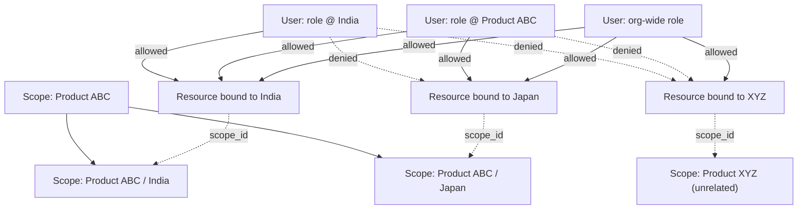

# Cross-Layer Authorization Hardening + Frontend Verification

A hardening pass between Layer 3 and Layer 4 — no new domain features,
no redesign. Two parts: (1) scoped authorization for Layer 2/3
resources, (2) a clean frontend verification pass. This file documents
both; `LAYER_1_FOUNDATION.md`, `LAYER_2_DOSSIER_CTD.md`, and
`LAYER_3_REGULATORY_INTELLIGENCE.md` are unchanged in substance.

## Part 1 — Scoped authorization

### The gap

Layer 1's `authorize()` already supported a `scope_id` parameter and the
ancestor-walk that lets a role held at "Product ABC" also authorize
"Product ABC / India" underneath it — Layer 1's own demo scenario (spec
§66) assigned a role exactly that way. But Layer 2 and 3 never had a
`scope_id` column on their resources, and every service/route call into
`authorize()` passed `scope_id=None`. A scoped-only assignment therefore
matched nothing: `authorize()`'s existing logic correctly treats a
`None`-scoped *resource* as outside a narrowly-scoped assignment's reach
(see "Design choices" below), so the seeded demo RA Specialist got 403
on every Layer 2/3 action.

### What changed

**No change to `authorize()` or to the RBAC/permission model.** The fix
is entirely in how Layer 2/3 resources carry and pass scope:

- Five tables gained a nullable `scope_id` FK to `scopes`: `products`,
  `regulatory_applications`, `dossiers`, `regulatory_activities`,
  `regulatory_intelligence_items` (migration `0006`). `NULL` = organization-wide,
  identical in meaning to a `UserRoleAssignment` with no scope.
- `dossier_service.py` and `intelligence_service.py` each gained:
  - `resolve_scope()` — validates a caller-supplied `scope_id` belongs
    to their own organization before it's stored or checked, so a scope
    from another tenant can never be used as a binding.
  - `filter_by_scope()` — the per-row visibility filter. It calls the
    **same** `authorize()` used everywhere else, once per candidate row,
    with that row's own `scope_id`. No parallel scope-matching logic
    exists anywhere.
- Every create function (`create_product`, `create_regulatory_application`,
  `create_dossier`, `create_regulatory_activity`,
  `create_intelligence_item`) now accepts an optional `scope_id`,
  resolves/validates it, and checks CREATE *at that scope* — a user
  scoped to India cannot claim `scope_id` = Japan just because they hold
  the CREATE action somewhere.
- Every transition/update/distribute/tag/link function now passes the
  **resource's own** `scope_id` into its permission check, not `None`.
- Every list/get route (`products`, `applications`, `dossiers`,
  `activities`, `intelligence`) now filters through `filter_by_scope`
  instead of returning every row in the organization.
- `associate_document_to_ctd`'s signature changed from taking a raw
  `dossier_id` to taking the already-loaded `Dossier` — placement is
  authorized using the **dossier's** scope, not a scope on CTD structure
  itself (CTD Module/Section remain global reference data with no
  organization or scope of their own, per Layer 2's original design;
  "can I place a document here" is really "can I edit this dossier").
- The seed script now **binds** the demo Product/Application/Dossier/
  Intelligence item to the existing "Product ABC / India" scope, and
  **backfills** that binding onto rows left over from a database seeded
  before this pass (same reasoning as the System Administrator
  stale-grant reconciliation from the Layer 3 pass: an idempotent seed
  must reconcile existing rows to the current definition, not silently
  skip them because they already exist).

### Design choices (worth being explicit about)

- **An org-wide (`scope_id=None`) resource is not implicitly visible to
  a narrowly-scoped assignment.** "The same user must not access
  resources outside that scope" is read strictly: unscoped is not
  automatically "inside" any particular scope. An org-wide
  *assignment*, by contrast, still sees everything — that asymmetry is
  intentional and is exactly what preserves existing behavior for
  every role that doesn't use scoping.
- **A broader scope grants access to every descendant**, not just a
  literal match — a role held at "Product ABC" reaches both
  "Product ABC / India" and "Product ABC / Japan". This was already
  true of `authorize()`; Layer 2/3 just never exercised it before.
- **Same-tenant-but-out-of-scope reads as 404, not 403**, matching the
  existing cross-tenant pattern (never confirm a resource exists to
  someone not authorized to see it) rather than introducing a second,
  more revealing denial style for scope specifically.
- **Distributed GLOBAL intelligence is exempt from scope filtering.** A
  CoLAB-owned item's `scope_id` (if any) lives in CoLAB's own scope
  tree, not the reading customer's — comparing them would be
  meaningless, and a naive uniform filter would have broken exactly the
  scoped-customer-sees-distributed-content case this pass exists to
  fix. `intelligence_service.filter_by_scope` special-cases rows owned
  by a different organization: their visibility is governed purely by
  the publish+distribution rule already built in Layer 3, never
  narrowed further. A dedicated regression test pins this.
- **Performance**: `filter_by_scope` is O(n) `authorize()` calls per
  list response. Acceptable at this layer's scale; a future
  optimization could precompute the caller's authorized scope set once
  and push the filter into SQL, but that would mean a second
  implementation of the ancestor-walk to keep in sync with
  `authorize()` — not worth it before there's an actual performance
  problem.

### Verification

Manually verified end-to-end against the real (Postgres-backed) dev
database via the live API — not just unit tests — for: the seeded demo
scenario itself (specialist now sees and can act on the seeded
Product/Dossier), cross-scope denial, sibling-scope denial, org-wide
regression, and ancestor-grants-descendant. All five matched the
expected outcome before the automated tests in
`tests/test_scoped_authorization.py` were written to pin them down
(15 tests: the five scenarios above across Product, plus Dossier
including transition, Application, Activity, CTD placement via a
dossier's scope, Intelligence including the global-distribution
exemption, and the cross-org `scope_id` rejection on create).

## Part 2 — Frontend verification

No frontend tooling existed before this pass (no lockfile, no ESLint
config, no test framework). All of the following were added or run for
the first time, not reconfigured.

| Check | Result |
|---|---|
| `npm install` (clean) | OK — 108 packages |
| TypeScript (`tsc --noEmit`) | OK — zero errors |
| ESLint (`next/core-web-vitals`, newly added — none existed) | OK — zero warnings/errors |
| Production build (`next build`) | OK — all 3 routes compile and prerender |
| Component tests (newly added — none existed) | OK — 10/10 passing |
| Playwright / real-browser E2E | **Not possible in this sandbox** — its browser-binary CDN is network-blocked here (`host_not_allowed`). See below for what was used instead. |

### A real security finding, and what was and wasn't done about it

`npm install` flagged Next.js 14.2.15 (the version this project was
built on) with disclosed high/critical advisories. npm's suggested fix
is `next@16.3.8` — a major-version jump with real breaking-change risk
(Next 15 made route params/searchParams async, among other changes),
which is a migration project, not a "minimum required fix," and would
have meant redesigning parts of the frontend this pass was explicitly
told not to touch.

What was actually done, within that boundary:
- **Bumped to `next@14.2.33`**, the latest patch on the same major
  line — a safe, same-API-surface update that resolved several of the
  flagged advisories outright.
- **`postcss`** (a transitive dependency, including a copy bundled
  inside `next` itself) was on a vulnerable version; pinned to `8.5.28`
  via `package.json` `overrides` so every copy in the tree — not just
  the top-level one — resolves to the patched version. This fully
  cleared that advisory.
- **Remaining:** 7 Next.js-core advisories have no fix within the 14.x
  line per npm's own advisory data — only `16.3.8`+. These are real and
  unresolved. See "Known limitations" below; a 14→16 migration is
  recommended as deliberate, separately-planned work, not something to
  do mid-hardening-pass.
- Separately, adding the lint and test *tooling itself* (`eslint-config-next`,
  `vitest`'s dependency tree) pulled in a few additional
  dev-only transitive advisories (`glob`, a second nested `next` copy
  used only by `eslint-config-next`'s own rule resolution). Confirmed
  via `npm audit --omit=dev` that **none of these reach the production
  dependency tree** — they affect local linting/testing only, never
  the shipped app.

### Verifying the Intelligence UI without a real browser

Since Playwright's browser download is blocked here, component tests
(Vitest + React Testing Library, both newly added) render the actual
production components in a simulated DOM (jsdom) with a mocked `fetch`
standing in for the API — real rendering and user interaction (clicks,
state updates), not a type check, but not a real browser either. This
is disclosed as a substitution, not claimed as equivalent to E2E.

Covered, against the items requested:
- **Intelligence dashboard** — renders; each of the seven widgets
  fires its own request.
- **All seven widgets** — titles match spec §11 exactly; each widget
  queries a distinct `intelligence_type` and only `status_filter=PUBLISHED`
  (one component, one data model, seven parameterizations — not seven
  systems, now actually demonstrated rather than just architecturally true).
- **IntelligenceCard** — title, type label, region, date, and impact
  badge render; a found gap (lifecycle status wasn't shown anywhere in
  the card) was fixed by adding a status marker for anything not
  `PUBLISHED` — the minimum change, not a redesign.
- **Intelligence detail view** — expanding "View details" shows
  summary, effective date, and the impact reason; collapsing hides them
  again.
- **Filtering** — two widgets with different `intelligenceType` props
  render disjoint result sets from independently mocked responses.
- **Global vs. tenant visibility** — a `scope: "GLOBAL"` item shows a
  "· CoLAB" marker; a `TENANT` item does not.
- **Unauthorized states** — a mocked 401 response surfaces its error
  message in the widget rather than silently showing nothing.

### Customer read-only behavior for CoLAB-owned intelligence

Honestly: **not separately verifiable in the frontend today, because
nothing in the Intelligence UI is editable yet for anyone.** Unlike the
Products panel (which has a working "move to next status" button for
dossiers), the Intelligence dashboard is read/browse only — no create,
edit, or transition controls exist in the UI. So "CoLAB-owned
intelligence is read-only for customers" holds, but trivially (nothing
is mutable from the UI regardless of ownership), not because of
scope/ownership-aware UI logic that was built and tested. The backend
enforces the real distinction (`test_3_tenant_administrator_cannot_modify_global_intelligence`
and others in `tests/test_layer3_tenant_isolation.py`); wiring that
through to the frontend is new feature work, which this pass — scoped
to hardening and verification — did not add.

## Regression

| Suite | Tests |
|---|---|
| Layer 1 | 17 |
| Layer 2 | 17 |
| Layer 3 (incl. the System Administrator allow-list hardening) | 33 |
| **New: scoped authorization** | **15** |
| **Backend total** | **82 / 82 passing** |
| Frontend component tests (new) | 10 / 10 passing |
| Frontend production build | Passing |
| Frontend typecheck + lint | Passing |

## Known limitations

- **CTD Module/Section have no scope of their own** (unchanged from
  Layer 2 — they're global reference data). Document placement is
  authorized via the dossier's scope, which is the correct level per
  the data model, but it means CTD structure itself cannot be
  restricted by scope independently of a dossier.
- **`filter_by_scope` is O(n) `authorize()` calls**, not SQL-pushed —
  fine at this scale, worth revisiting if list endpoints grow large.
- **Next.js has 7 unresolved core advisories** with no fix in the 14.x
  line; closing them requires a deliberate major-version migration
  (14→15 or 14→16) with its own dedicated testing pass, not attempted
  here.
- **No real browser E2E was run** — this sandbox cannot download one.
  Component tests are a real but partial substitute; they don't cover
  actual browser rendering, CSS, or cross-browser behavior.
- **Intelligence has no mutation UI** — create/edit/transition/distribute
  all exist as working, tested APIs (Layer 3) but have no frontend
  controls yet, so scope- and ownership-aware *UI* behavior (as opposed
  to API behavior) is unverified because it doesn't exist yet.
