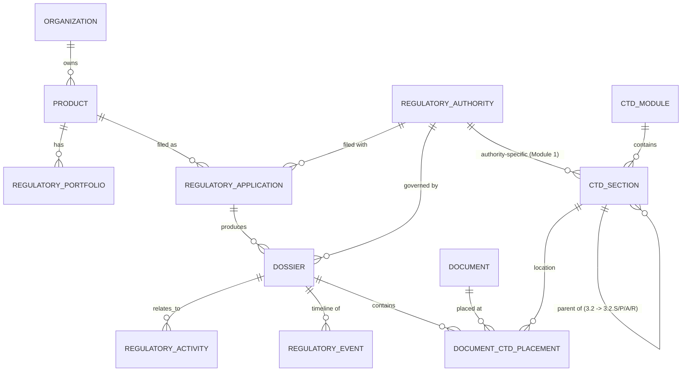
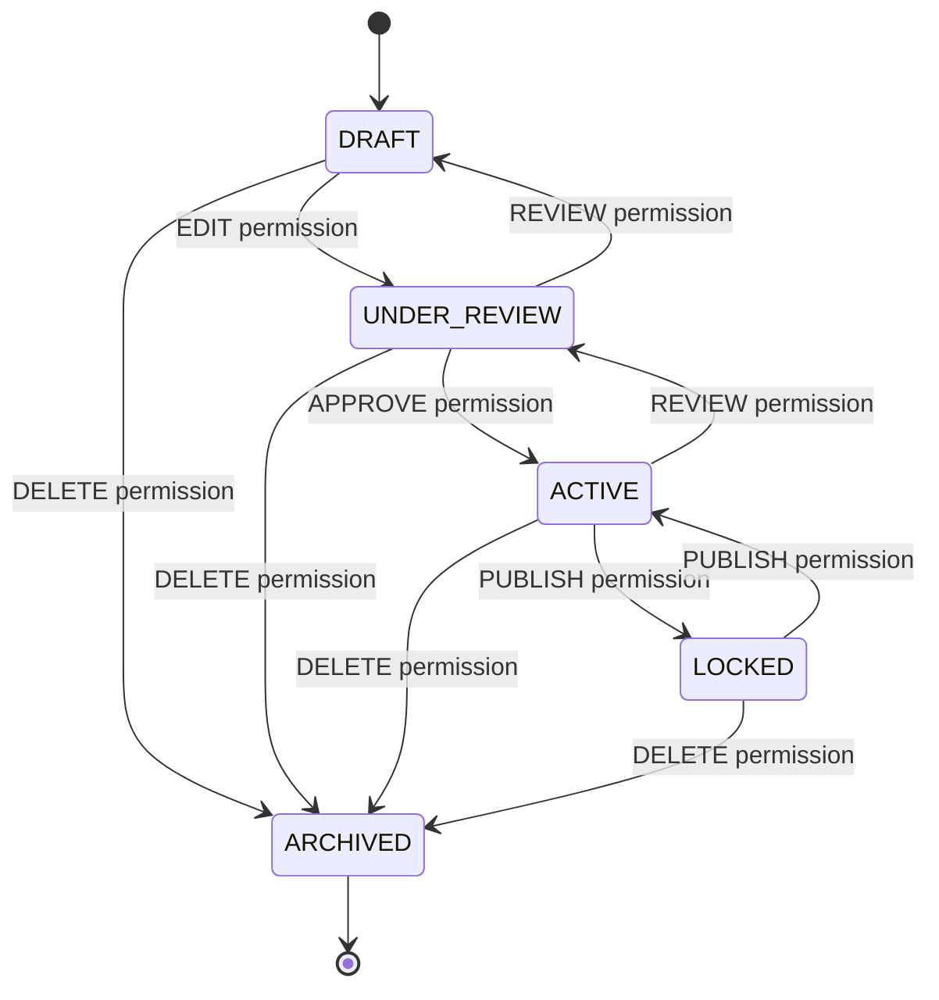
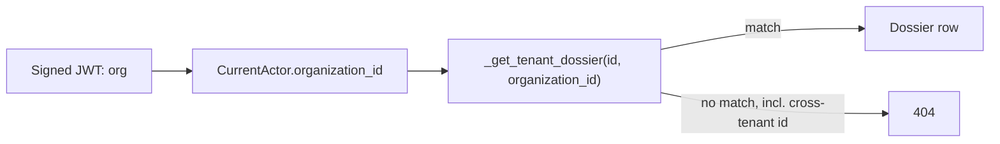

# RAISA Synapse — Layer 2: Dossier & CTD Foundation

Consolidates the ten documents spec §31 asks for into one file, same
reasoning as `LAYER_1_FOUNDATION.md`. Read that file first — this one
assumes Layer 1 (multi-tenancy, auth, RBAC/scope/SoD, audit, document
storage foundation, standards registry, themes) is already in place and
**unchanged**: nothing in Layer 2 modifies Layer 1's authorization
engine, and Layer 1's 17 tests still pass byte-for-byte unmodified.

## What Layer 2 adds

Product → Regulatory Portfolio → Regulatory Application → Dossier →
CTD Module → CTD Section → Document, plus Regulatory Activity and a
Regulatory Event timeline alongside it. Every one of these reuses
Layer 1's `authorize()`, `audit_service`, and tenant-resolution-from-JWT
— nothing here re-implements authorization or invents a second way to
find "which tenant."

### Database entities created

| Entity | Table | Notes |
|---|---|---|
| Product | `products` | Tenant-owned. `RegulatoryPortfolio` groups a product's regulatory work |
| Regulatory Authority | `regulatory_authorities` | **Global** reference data (FDA, EMA, CDSCO seeded) — not tenant-owned |
| Regulatory Application | `regulatory_applications` | Tenant-owned; links Product + Authority |
| Dossier | `dossiers` | Tenant-owned; owns the lifecycle state machine (see below) |
| CTD Module / Section | `ctd_modules` / `ctd_sections` | **Global** reference data — the populated realization of the registry architecture Layer 1 §34 left empty |
| Document ↔ CTD placement | `document_ctd_placements` | Join table: a document's location(s) in a dossier's CTD structure — deliberately a join, not columns on `Document`, so a document can occupy more than one location once a future Context of Use engine needs that |
| Regulatory Activity | `regulatory_activities` | Tenant-owned; the future Submission Builder/Sequence/Response Center attach here |
| Regulatory Event | `regulatory_events` | Business-facing timeline, tenant-owned; always written alongside an `AuditEvent`, never instead of one |

`Document` (Layer 1) gained one nullable column: `document_type`.

### Entity relationship diagram

### Dossier lifecycle

Enforced in `services/dossier_service.py`: `ALLOWED_DOSSIER_TRANSITIONS`
is the state machine (an edge not listed there is rejected — HTTP 409 —
regardless of permissions), and `_TRANSITION_PERMISSION` is what makes
"EDIT gets you to review, only APPROVE gets you to active, only PUBLISH
locks it" literally true rather than a design intention. Both are
plain Python dicts, readable top to bottom, not derived logic.

### Permission matrix (Layer 2 additions)

| Role | PRODUCT | APPLICATION | DOSSIER | ACTIVITY |
|---|---|---|---|---|
| RA Trainee / Associate | VIEW | VIEW | VIEW, CREATE, EDIT | VIEW |
| Senior RA Specialist / Lead | VIEW, CREATE | VIEW, CREATE | + REVIEW | + CREATE |
| RA Manager / Country Lead | + EDIT | + EDIT | + APPROVE, PUBLISH, EXPORT | (same) |
| Publishing / eCTD Specialist | VIEW | VIEW | VIEW, EDIT, PUBLISH | VIEW |
| Head of RA / Executive | VIEW | VIEW | VIEW, APPROVE | VIEW |
| External Consultant / CRO | — | — | VIEW, CREATE, EDIT | — |
| Tenant Administrator | full | VIEW, CREATE, EDIT | VIEW | VIEW |
| Auditor | VIEW | VIEW | VIEW | VIEW |
| System Administrator | **none** | **none** | **none** | **none** |

System Administrator's row is the point of `test_seeded_system_administrator_cannot_view_documents`
extended in spirit — Layer 2 excludes `PRODUCT_*`/`DOSSIER_*`/`APPLICATION_*`/`ACTIVITY_*`
from its grant the same way Layer 1 excluded `DOCUMENT_*`.

### Multi-tenant isolation

Identical mechanism to Layer 1 — nothing new invented. Every Layer 2
route resolves `organization_id` from the JWT (`core.deps.CurrentActor`),
every query filters on it, and every dossier/application/product
lookup-by-id goes through a single tenant-filtered helper
(`_get_tenant_dossier` in `api/v1/dossiers.py`) so a cross-tenant id
returns 404, never 403 (which would confirm the id exists elsewhere).

### Mobile-readiness notes (spec §23)

Every Layer 2 endpoint is plain JSON REST under `/api/v1`, authorized
via the same Bearer JWT Layer 1 already issues — a mobile client
authenticates and calls these exact endpoints, no separate mobile API,
no separate tenant model, no duplicated authorization. Nothing mobile-
specific was built (no native app, no mobile-only fields) per spec §23's
own instruction.

### AI / Knowledge Graph readiness (spec §24-25)

The chain Tenant → Product → Application → Dossier → CTD Module →
Section → Document → Version is real foreign keys today, not inferred
from folder paths — a future retrieval layer walks these FKs and never
needs `authorize()` bypassed, because there is no code path (Layer 2 or
Layer 1) that returns a row without the tenant filter applied first.
`DocumentCTDPlacement` as a join table (rather than columns on
`Document`) is specifically so a future Context of Use engine can
attach a second placement without a schema rewrite.

## Future-layer dependency map

- **Layer 3** (Module 2 AI drafting) attaches to `CTDSection` rows
  under Module 2 and `DocumentCTDPlacement` — no schema change expected.
- **Layer 4** (eCTD engine, Sequence Management) reads `RegulatoryActivity`
  and will very likely add a `Submission` entity that `RegulatoryActivity`
  already has a placeholder relationship shape for (`dossier_id`,
  `regulatory_application_id`).
- **Layer 5** (Response Center) attaches to `RegulatoryActivity` via
  `activity_type=RESPONSE`/`DEFICIENCY`.
- **Layer 8** (GxP validation, e-signature workflow) has a home already:
  Layer 1's `ElectronicSignature` table, untouched by Layer 2.

## Known limitations / explicitly deferred

- No UI for creating/editing Products, Applications, or CTD placements
  yet — the dashboard's Products tab is read + dossier-lifecycle-advance
  only; creation happens via API or seed data. Full forms are next.
- `RegulatoryPortfolio` has a model and migration but no API routes yet
  (Product and Dossier are directly linked; the portfolio grouping
  layer is defined but not yet exposed).
- No search endpoint beyond the `product_id`/`dossier_id` query-param
  filters already on the list routes — spec §21 explicitly asks for
  structured filtering only in Layer 2, which is what those are.
- Frontend has not been `npm install`-verified in this sandbox pass
  (same caveat as Layer 1); the backend, including every Layer 2 route,
  has been.

## Confirmations (spec §32 Definition of Done / Final Instruction)

- **Layer 1 continues to work**: all 17 original tests pass unmodified,
  plus one pre-existing latent bug (a logging formatter crash on any
  third-party library log line) found and fixed while extending the
  test surface — see `app/main.py`'s logging setup and its inline
  comments.
- **Cross-tenant isolation passes**: `tests/test_layer2_tenant_isolation.py`
  proves Tenant A cannot fetch, list, or transition Tenant B's Dossier,
  Product, or Application by any means, including a known UUID.
- **Layer 2 has stopped at its boundary**: no eCTD/XML generation, no
  Submission Unit or Sequence Management, no Context of Use engine, no
  validation engine, no FDA/EU transmission, no AI writing or "Generate
  Summary" action, no Response Center, no Regulatory Intelligence, no
  Knowledge Graph, no full workflow engine, no native mobile app, no
  e-signature *workflow* (the data model from Layer 1 is untouched and
  unused beyond that), no semantic/vector search. 34/34 tests pass
  (17 Layer 1 + 17 Layer 2).
