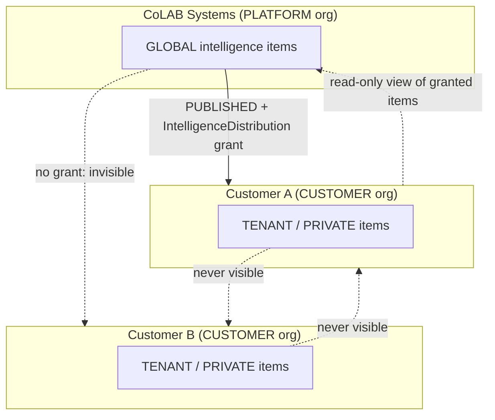
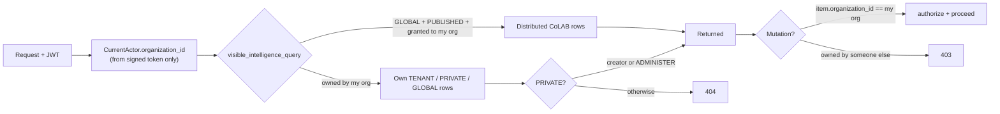
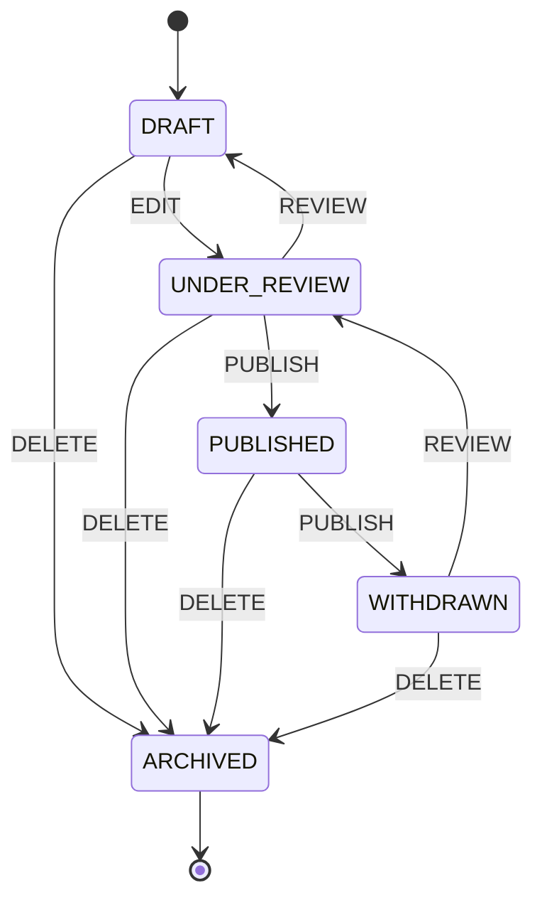
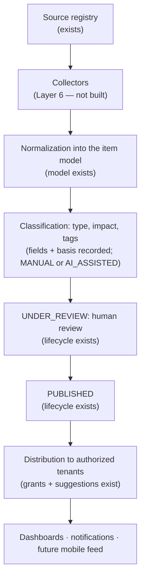

# RAISA Synapse — Layer 3: Regulatory Intelligence Foundation

Read `LAYER_1_FOUNDATION.md` and `LAYER_2_DOSSIER_CTD.md` first. Layer 3
adds the intelligence domain on top of them and changes **none** of
Layer 1's `authorize()` logic; all Layer 1 and Layer 2 tests pass
unmodified.

## The one design decision that shapes everything

Intelligence exists at two levels — **global** (operated by CoLAB,
consumed by many customers) and **tenant** (a customer's own). The
obvious way to model "global" is a nullable `organization_id`, but that
would mean a second authorization path everywhere. Instead:

- **CoLAB Systems is a real organization** (`organization_type =
  PLATFORM`; customers are `CUSTOMER`). It owns global intelligence the
  way any tenant owns its rows. Every intelligence row has a real
  `organization_id`. No NULL special case, no magic tenant-zero id — the
  platform org is found by `organization_type`, never by a hard-coded UUID.
- **Reading** is a query-level rule (`visible_intelligence_query`): a
  caller sees rows owned by their own org, **plus** GLOBAL items that are
  PUBLISHED *and* explicitly granted to their org.
- **Writing** is single-tenant, always: mutations require the item to be
  owned by the caller's org. Being *able to read* a distributed CoLAB
  item never implies being able to change it.

`authorize()` still only answers "does this user hold permission P in
their own org". The extra read clause lives in the service layer, where
Layer 1/2's ordinary tenant filters already live.

## Data model

| Entity | Table | Notes |
|---|---|---|
| Organization (extended) | `organizations.organization_type` | `PLATFORM` / `CUSTOMER`; existing orgs backfilled to `CUSTOMER` |
| Regulatory Intelligence Item | `regulatory_intelligence_items` | Always has a real `organization_id`; `scope` GLOBAL/TENANT/PRIVATE; 9 types; impact level **plus required reason + assessor + `MANUAL`/`AI_ASSISTED` marker** |
| Intelligence Source | `intelligence_sources` | Global reference data; collection method/frequency recorded, nothing collected yet |
| Tags | `intelligence_tags`, `intelligence_item_tags` | Configurable vocabulary (`tag_type` + `name`), not hard-coded |
| Distribution grant | `intelligence_distributions` | The **only** thing that gates a customer's visibility of a GLOBAL item |
| Object link | `intelligence_object_links` | Links to Product / Portfolio / Application / Dossier / Activity / CTD Module / CTD Section |
| Tenant preferences | `configurations` (Layer 1 table) | Key `intelligence_preferences`, per-org JSON — no new table |
| Notifications | `notifications` (Layer 1 table) | Now actually written to; see below |
| Regulatory Event (extended) | `regulatory_events.intelligence_item_id` | Reuses Layer 2's event table; 3 new event types |

`full_content_reference` is a *reference* (URL / citation / document id),
not a blob of scraped text (spec §2). Impact classification is never a
bare label: `impact_reason` is required, `impact_assessed_by` records who,
`impact_assessment_source` records whether a human or (later) an AI
assisted — the model never assumes AI is the assessor.

Migrations: `0003` (tables + `organization_type`), `0004` (event FK + event
types), `0005` (audit event types). Postgres enum labels are added by
hand-written `ALTER TYPE` statements (Alembic can't autogenerate them).

## Visibility rules

| Item scope | Owned by | Who can read it |
|---|---|---|
| GLOBAL | CoLAB (platform org) | CoLAB users; a customer only if status is PUBLISHED **and** a distribution grant exists for their org |
| TENANT | a customer org | Everyone in that org with `INTELLIGENCE_VIEW` |
| PRIVATE | a customer org | The creator, and holders of `INTELLIGENCE_ADMINISTER` in that org |

Cross-tenant ids return **404**, never 403 (a 403 would confirm the id
exists). CoLAB staff do *not* automatically see customers' TENANT/PRIVATE
items — platform membership is not a back door into tenant data.

### Who may create what

`GLOBAL` items, the source registry, and the shared tag vocabulary are
CoLAB-managed. Permission grants alone can't enforce that (a customer can
define a custom role holding any permission), so these writes **also
require the caller's organization to be `PLATFORM`**. Without that, a
customer admin could create a GLOBAL item, own it, and distribute it into
other tenants' feeds. An item's `scope` is fixed at creation — update
requests can't change it (extra fields are rejected with 422).

## Source registry

`IntelligenceSource` holds name, type, authority, region, URL, collection
method, frequency, reliability notes, last attempted/successful
collection, active flag and free-form configuration. Nothing is
hard-coded in application logic; the seed adds three illustrative rows.
No collection method is *implemented* — the fields record how a source
would be collected once Layer 6 builds ingestion.

## Permissions

New domains: `INTELLIGENCE_SOURCE`, `INTELLIGENCE_CONFIGURATION`
(`INTELLIGENCE` already existed from Layer 1). Existing roles are reused —
**RA Manager / Country Lead** carries the Regulatory Manager capability and
**Senior RA Specialist / Lead** the Regulatory Specialist capability;
no duplicate roles were created.

| Role | Intelligence capabilities |
|---|---|
| CoLAB Super Admin | Everything, within the CoLAB org |
| Tenant Administrator | VIEW, CREATE, EDIT, PUBLISH, ADMINISTER on **its own org's** items; configure tenant preferences. Cannot touch GLOBAL items (ownership rule, not just missing grants) |
| RA Manager (Regulatory Manager) | VIEW, REVIEW; VIEW preferences |
| Senior RA Specialist (Regulatory Specialist) | VIEW, CREATE, EDIT |
| Others (Trainee, Publisher, Head of RA, Consultant, Auditor) | VIEW |
| **System Administrator** | **None** — see below |

**System Administrator** is now defined by an *allow-list* of technical
domains (USER, ROLE, ORGANIZATION, ACCESS, STANDARDS, and AUDIT
view-only). The earlier deny-list ("everything except…") silently granted
every domain a later layer added, and the add-only seed never revoked
old grants. The seed now reconciles that role to its exact set (revoking
stale grants), and `tests/test_seed_role_invariants.py` fails if any
domain outside the allow-list is ever granted to it.

## Lifecycle

An edge not in the map is a 409 regardless of permissions. Field edits
(`PATCH`) are allowed only in DRAFT/UNDER_REVIEW — a correction to
published intelligence goes withdraw → review → republish so the
published record stays traceable. Changing `impact_level` requires a new
`impact_reason` and is audited as a classification change.

## API (all under `/api/v1/intelligence`)

| Method & path | Purpose |
|---|---|
| `GET /` | List with filters: `intelligence_type`, `authority_id`, `country_region`, `impact_level`, `status_filter`, `therapeutic_area`, `tag_id`, `limit` |
| `GET /{id}` · `POST /` · `PATCH /{id}` | View / create / update |
| `POST /{id}/transition` | Submit, review, publish, withdraw, archive |
| `POST /{id}/distribute` · `GET /{id}/distribution-suggestions` | Grant a tenant access · which tenants' saved interests match |
| `POST /{id}/tags/{tag_id}` · `POST /{id}/links` | Tag · link to a regulatory object |
| `GET/POST /sources` · `PATCH /sources/{id}` | Source registry |
| `GET/POST /tags` | Tag vocabulary |
| `GET/PUT /preferences` | The caller's own org's interests (no org id parameter exists) |

All responses are plain JSON under the same Bearer-token auth as Layer 1
and 2 — the future mobile app consumes exactly these endpoints; nothing
here is web-specific. Invalid enum values are 422 (Layer 2's request
schemas had the same weakness — bad enum strings caused a 500 — and are
fixed too).

## Dashboard

One reusable `IntelligenceCard` (title, type, region, date, impact badge,
scope marker, expandable summary/effective date/impact basis) and one
`IntelligenceWidget`. The seven widgets — Tender Alerts, Patent Cliff
Monitor, Para IV Tracker, Industry News, Guideline Updates, Upcoming
Events, Regulatory Alerts — are the **same component** with a different
`intelligence_type`, i.e. one data model and one API call shape, not
seven systems. The Intelligence tab shows all seven; the Dashboard's
former "Global Intelligence" placeholder is now a live "Latest
Intelligence" widget. Both themes work because the components use the
theme tokens (impact badges are semantic status colors on purpose).

## Notifications

`notification_service` writes Layer 1's `Notification` rows. Today: when a
CRITICAL or HIGH impact GLOBAL item is distributed to a tenant, that
tenant's Tenant Administrators get an `UNREAD` notification with the
item's title and summary. Nothing else fires automatically, and there is
no push/email/mobile delivery — the model and service are the foundation
for it.

## Distribution and configured interests

Customer interests (countries, authorities, therapeutic areas,
intelligence types) are stored per tenant. They do **not** act as a
second visibility gate — an explicit grant always wins. Instead,
`distribution-suggestions` tells CoLAB which tenants an item *would*
match: opt-in (no saved interests → matches nothing); every dimension a
tenant specified must match, except that an item with no value on a
dimension is treated as unconstrained. Suggestions only — nothing is
distributed automatically.

## Centralized ingestion (architecture; not built)

One ingestion, review, and publication pass serves every authorized
customer, instead of each tenant or user triggering its own research/AI
run. Every item carries source, source URL, timestamps, publication date
and classification basis, so nothing AI-produced can appear as an
untraceable regulatory fact; a future pipeline must write into this same
model.

## AI and mobile readiness

Structured fields answer "what changed / where / which authority / when
/ which products / which regulatory area / what impact / what action":
title+summary, `country_region`, `authority_id`, publication/effective/
expiry dates, object links, `regulatory_area`, `impact_level`+reason.
Retrieval must go through `visible_intelligence_query` — there is no
code path that returns a row without the tenant/distribution rule
applied. No assistant, AI summarization, semantic search, or crawler
exists in this layer.

## Audit

Everything goes through Layer 1's `audit_service`, with precise types:
`INTELLIGENCE_CREATED`, `_UPDATED`, `_STATUS_CHANGED` (publish/withdraw/
review carry previous+new state and reason), `_CLASSIFICATION_CHANGED`
(impact changes with before/after), `_DISTRIBUTED`, `_SOURCE_CHANGED`,
and `CONFIGURATION_CHANGED` for tenant preference changes (previous and
new value). Lifecycle changes also write a `RegulatoryEvent`
(reusing Layer 2's event table), as Layer 2 does for dossiers.

## Future-layer dependencies

- **Layer 6** builds collectors that write into this model and drive
  `UNDER_REVIEW`; automated distribution builds on the suggestion logic.
- **Layer 7** (assistant) retrieves through `visible_intelligence_query`.
- **Layers 4/5** can attach intelligence to dossiers/activities through
  the existing object links.
- Mobile consumes the existing endpoints.

## Known limitations and issues found

- **Scoped role assignments don't satisfy Layer 2/3 checks.** `authorize()`
  counts a scoped assignment only for scope-aware checks; Layer 2/3
  service checks are org-level because Products/Dossiers/Intelligence
  aren't mapped to Scope nodes. So a user whose *only* assignment is
  scoped — the seeded demo RA specialist ("Product ABC / India", the
  Layer 1 spec's own scenario) — cannot do Layer 2/3 writes. This
  predates Layer 3 (Layer 2's tests used org-wide roles, so it went
  unnoticed) and is pinned by a test. The seeded demo RA manager is now
  org-wide; use it or `tenant.admin@example.com` for the demo. Real fix:
  resolve resources to scopes.
- **Preferences drive suggestions only**; no automatic distribution, and
  no per-user notification targeting (Tenant Administrators only).
- **Tags and sources are platform-managed.** Tenant-custom tags would
  need an org-scoped tag table.
- **PRIVATE visibility** is creator + `INTELLIGENCE_ADMINISTER`; there is
  no per-user access list.
- **Source URLs and `full_content_reference` are stored, not validated or
  fetched.**
- **The frontend** was not `npm install`-verified in the sandbox (same
  caveat as earlier layers); every API it calls is covered by backend
  tests.

## Confirmations

- **No Project Management** functionality (projects, Gantt, milestones,
  tasks, templates, dependencies, risks) was added, and Layer 2 was not
  modified to accommodate any.
- **Layer 3 stopped at its boundary:** no assistant/chatbot, AI
  summaries or web research, crawler, semantic/vector search, Module 2
  Generate Summary, Response Center, eCTD publishing/XML, Context of Use,
  Submission/Sequence engines, validation engine, gateway transmission,
  native mobile app, or e-signature workflow.
